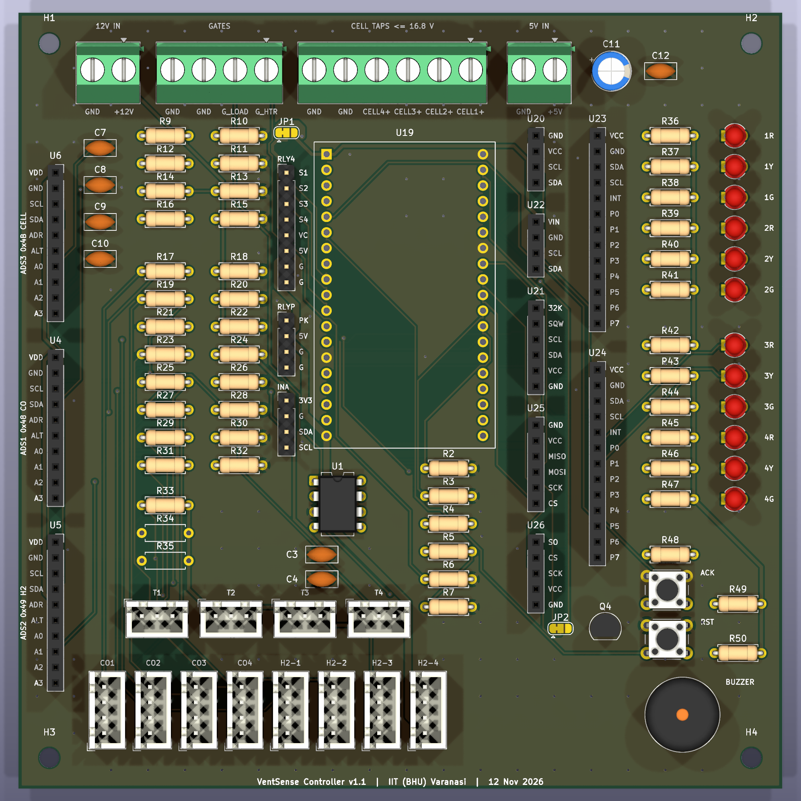
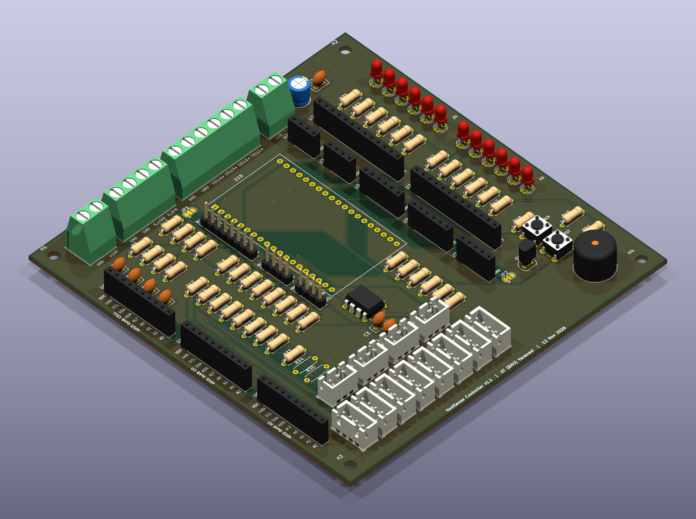

# VentSense Controller Carrier PCB, v1.1

A 2-layer carrier board for the VentSense controller. The ESP32-DevKitC-32E and three ADS1115 ADC modules plug into it. It holds the cell-voltage and gas-sensor dividers, the TC4427 gate driver, the status LEDs, the buzzer and the buttons. It also has screw terminals and headers that connect to the off-board power stage, the relay modules and the sensors.

Only signal and logic-supply currents pass through this board. The heater, load and battery-pack currents stay on off-board wiring.

**To order the board, read [ORDERING.md](ORDERING.md).**

## Folder contents

| Folder / file | What it is |
| --- | --- |
| [`fabrication/VentSense_Carrier_Gerbers_v1.1.zip`](fabrication/VentSense_Carrier_Gerbers_v1.1.zip) | **The file to send to the PCB fab** (Gerbers + drill files) |
| [`fabrication/gerbers/`](fabrication/gerbers/) | The same files unzipped, for viewing |
| [`bom/VS_Carrier_BOM_v1.1.csv`](bom/VS_Carrier_BOM_v1.1.csv) | Parts that solder onto this board (62 lines, 103 parts; R34/R35 marked DNP; the copper solder jumpers JP1/JP2 need no part) |
| [`bom/VS_BOM_v1.1_all.csv`](bom/VS_BOM_v1.1_all.csv) | Full schematic BOM, including off-board parts |
| [`docs/VS_schematic_v1.1.pdf`](docs/VS_schematic_v1.1.pdf) | Full schematic (6 sheets) |
| [`docs/VS_ERC_v1.1.rpt`](docs/VS_ERC_v1.1.rpt) | Electrical rules check: 0 errors, 0 warnings |
| [`docs/VS_DRC_v1.1.rpt`](docs/VS_DRC_v1.1.rpt) | Design rules check: 0 violations, 0 unconnected, 0 parity issues |
| [`renders/`](renders/) | 3D views: top, isometric, bottom |
| [`archive_v1.0/`](archive_v1.0/) | Superseded v1.0 outputs. **Do not order.** |
| [`../kicad/VentSense_Stage2/`](../kicad/VentSense_Stage2/) | Native KiCad 10 project (schematic + PCB source) |

## Board summary

- **Board:**
  - 124 × 126 mm, 2 layers, FR-4 1.6 mm, 1 oz copper, HASL.
  - 4 × M3 mounting holes.
  - All through-hole.
- **Routing:**
  - Track widths: `+5V` 1.0 mm; `+3V3`, `GND` and relay VCC 0.5 mm; `+12V` 0.4 mm (TC4427 supply only); signals 0.25 mm.
  - Ground fill on both layers, stitched with vias.
- **Connectors:**
  - Screw terminals (5.08 mm): 12 V in, gate outputs to the off-board IRLZ44N MOSFETs, cell taps (16.8 V max, on their own connector), 5 V in.
  - Headers: 4-channel relay module, pack relay module, INA219.
  - JST-XH: 8 gas sensors, 4 DS18B20 probes.
- **Sockets:**
  - The ESP32-DevKitC sockets are 25.40 mm apart, per Espressif's DevKitC V4 drawing.
  - The OLED, BME280, DS3231, microSD, MAX6675 and PCF8574 modules have labelled sockets and connect with jumper leads.
- **Solder jumpers:**
  - **JP1 (relay module VCC):** 1-2 = +5 V (default), 2-3 = +3.3 V.
  - **JP2 (MAX6675 SO):** 1-2 = shared SPI MISO / IO19 (default), 2-3 = IO36.

## Revision history

- **v1.1 (Nov 2026):** board built for fabrication.
  - Added the off-board connectors, the 5 V input capacitors, and the relay-VCC and MAX6675 jumpers.
  - Set net-class track widths and stitched ground fills; screw terminals face the board edge.
  - Corrected the tactile-switch footprint to the standard 4-pin 6 × 6 mm.
  - Board grew to 124 × 126 mm.
- **v1.0 (Oct 2026):** Stage 2 design layout. Superseded.
