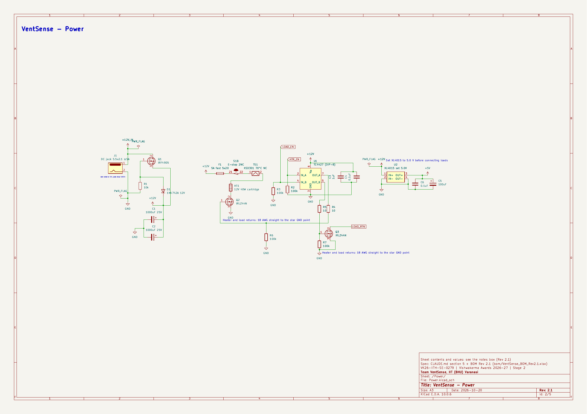

# VentSense

**A low-cost safety add-on for small lithium-ion packs that catches a failing cell earlier than a normal BMS and switches out only that cell.**

Vishwakarma Awards 2026-27 · Stage 2 (Design Specification) · Sustainable Energy track (mentor: IIT Hyderabad) · Application ID **VK26-IITH-SE-0279** · Team VentSense, IIT (BHU) Varanasi

This repository holds the **electronics design files** for our Stage 2 submission: the complete KiCad schematic, its check reports and the bill of materials. The rest of the design (CAD, thermal FEA, safety analysis) is in the Stage 2 deck.



## The idea

A failing lithium cell fails in a fixed order: abuse, then **off-gassing** (CO and H2), then voltage and heat change, then fire. Most small packs only watch temperature and voltage, which are among the last signals to change. VentSense watches three independent signals on every cell segment:

| Signal | Sensor | Why |
| --- | --- | --- |
| Gas | MQ-7 (CO) and MQ-8 (H2) | A cell vents gas before it gets hot |
| Temperature | DS18B20 on the cell wall | Rate of rise on that cell |
| Voltage | Divider into a 16-bit ADC | A sag relative to its neighbours that the load current does not explain |

An ESP32 applies **2-of-3 voting** per cell:

| Level | Trigger | Action |
| --- | --- | --- |
| Normal | All signals at baseline | Log only |
| Level 1 | One signal crosses its threshold | Alert only |
| Level 2 | Two signal types cross on the same cell within 60-120 s | Drop that cell's bypass relay; the other cells keep powering the load |
| Level 3 | Two or more cells reach Level 2 | Open the pack relay |

Levels 2 and 3 stay latched until someone presses the reset button. The relays are **fail-secure**: energised means the cell is in the string, so a crash, reset or power loss isolates every cell. The ESP32 hardware watchdog backs this up.

## Our claim, kept narrow

Gas-based and voltage-based battery safety already exist (Li-ion Tamer, Metis Engineering, patents US11942613B2 and US11567145B2, and a Feb 2026 single-CO-sensor student paper). **We do not claim to have invented either.** Our claim is the combination: **2-of-3 voting across dissimilar signals plus per-cell isolation, in a low-cost retrofit for small packs** (e-scooters, e-rickshaws, drones, home solar storage).

We have **not tested against a real cell failure**; the early-warning figures come from published research. The demonstrator is a 4-cell rig, not a production pack, and tests use safe stand-ins only (heater block capped at 70 °C, incense for CO, a small electrolysis cell for H2). We never abuse a real cell.

## Electronics design

The schematic is hierarchical, with four sheets:

| Sheet | Contents |
| --- | --- |
| `Power` | 12 V input with IRF4905 reverse-polarity protection, heater branch (5 A fuse, E-stop contact, 70 °C thermal cutoff, 40 W cartridge), TC4427 gate driver with IRLZ44N switches, XL4015 5 V buck |
| `Pack_Path` | Four cells, four SPDT bypass relays with per-segment PTC fuses, pack relay, E-stop, 3 A fuse, INA219 current monitor, XT60 output, 10 ohm test load |
| `Measurement` | 4 cell-voltage dividers and 8 gas-output dividers into three ADS1115 ADCs (0x48, 0x49, 0x4B), 8 MQ modules, 4 DS18B20 probes on one 1-Wire bus |
| `MCU_IO` | ESP32-DevKitC-32E, OLED, RTC, BME280, microSD, MAX6675 thermocouple reference, 2 x PCF8574 driving 12 status LEDs, buzzer driver, acknowledge and reset buttons |

Design points worth a judge's attention:

- **Fail-secure relays.** Each cell has a changeover relay: COM to the string node above, NO to the cell, NC to the node below. De-energised, the string jumps the cell and its positive terminal is left open. The relay breaks before it makes, so it never shorts a cell. Relay inputs float at ESP32 reset, so relays also stay off during boot.
- **Heater test cannot overheat a real cell.** The test heater has a 70 °C hardware cutoff (the Samsung INR18650-25R is rated to 60 °C ambient in discharge) and a firmware stop at 55 °C on the cell probe, and the E-stop cuts both the pack output and the heater line.
- **Logic-level switching done properly.** The IRLZ44N is specified at a 4-5 V gate, so a TC4427 driver on 12 V switches the heater and load instead of the 3.3 V ESP32 pin; driver inputs have pull-downs so nothing switches while the ESP32 boots.
- **Cell voltage resolution, honestly stated.** About 0.75 mV per cell is the ADC *resolution*. Uncalibrated 1% dividers can put the top cell off by about 0.5 V in the worst case, so the firmware calibrates each channel against a multimeter.
- **Single star ground** joins pack negative and logic ground, so the ADC can read the cell voltages; heater and load returns run straight to it.

Modules (ESP32 DevKit, ADS1115, relay boards, MQ sensors and so on) are drawn as header symbols with their real pinouts, in the project library `VentSense_Modules.kicad_sym`. Pin orders follow the common module and are to be verified against the boards we receive.

## Checks

| Check | Result |
| --- | --- |
| KiCad electrical rules check (ERC) | **0 errors, 0 warnings** (`exports/VS_ERC.rpt`) |
| Netlist reviewed against the design specification, all four sheets | Done |
| Component values checked against datasheets (ADS1115, TC4427, INA219, IRF4905, IRLZ44N, ESP32, PTC and others) | Done; open items are module-specific checks on arrival |

## Bill of materials

`bom/VentSense_BOM_Rev2.1.xlsx`: core parts INR 22,882, spares INR 6,186, 10% contingency INR 2,907, **grand total INR 31,975** (prices are our estimates from Indian online vendors, Sept-Oct 2026, including GST). `exports/VS_kicad_bom.csv` is the KiCad export, one line per reference designator.

## Repository contents

```
kicad/VentSense_Stage2/   KiCad 10 project: root + 4 sheets, custom module symbol library
exports/                  schematic PDF (all sheets), one PNG per sheet, ERC report, KiCad BOM CSV
bom/                      full bill of materials (Rev 2.1)
```

To open the design, use **KiCad 10** and open `kicad/VentSense_Stage2/VentSense_Stage2.kicad_pro`. No other setup is needed: the project library is registered in `sym-lib-table`.

## Status

Stage 2 is a design submission, so **no prototype exists yet**. The physical build, firmware and bench tests follow after Stage 2. The carrier PCB layout and its design-rule-check report are not in this repository yet; they will be added when complete.
